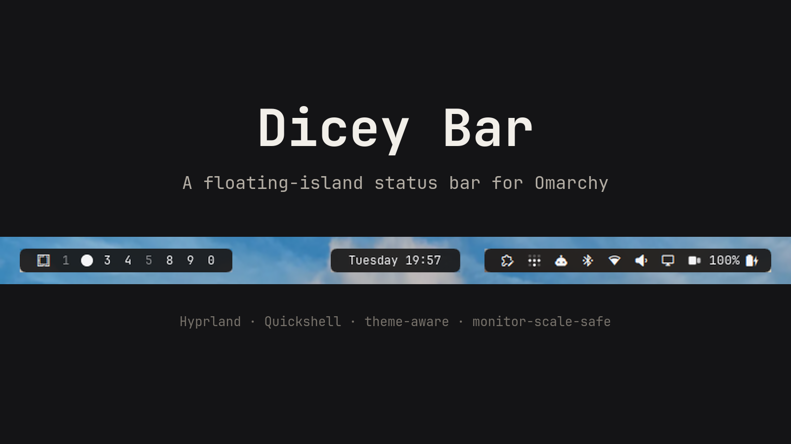
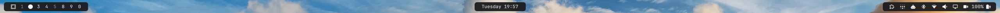
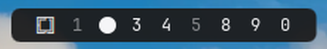
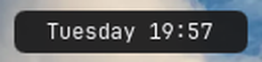
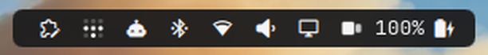
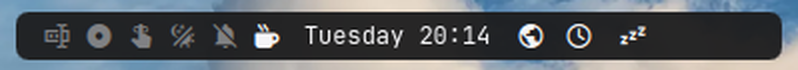
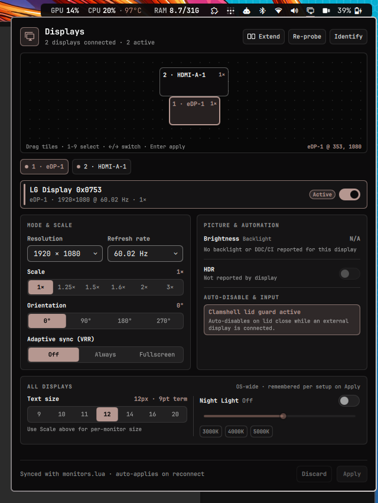

# Dicey Bar

**A refined floating-island status bar for [Omarchy](https://omarchy.org/).**
Theme-aware, drop-in, and built to feel native to your desktop.

[](https://github.com/dicey-dev/dicey-bar/releases)
[](THIRD_PARTY_NOTICES.md)




**Alpha software (0.x).** The current release is **v0.2.0**. Expect rough edges
and possible compatibility changes; validation is not a stability guarantee.

An independent Omarchy plugin repository. The plugin ID is **`dicey.bar`**;
no other Dicey repository, installer, or synchronization service is required.

## Screenshots

The full bar on a 2560px monitor:



| Left: launcher and workspaces | Center: clock | Right: tray and system status |
| :---: | :---: | :---: |
|  |  |  |

Hover the clock and the center island expands to show its indicators and the
other center widgets. The clock stays where it is:



Click the monitor icon in the right island to open the built-in **Displays**
panel — drag-and-drop monitor arrangement, Extend/Mirror toggle, per-monitor
mode/scale/orientation/VRR/HDR/brightness/DDC controls, and OS-wide text size
and Night Light:



These captures use the author's own theme and widget layout. The islands show
whatever widgets your bar layout lists, so some icons above come from separate
widget plugins rather than from Dicey Bar itself.

## Features

- **Floating islands.** The bar surface is transparent. The left, center and
  right sections each draw their own rounded island, with a small gap from the
  screen edge.
- **Theme-aware.** Islands use Omarchy's theme colors and style tokens, so
  theme and font changes apply straight away.
- **Safe across monitor and scale changes.** `ScaleSafeRemap.qml` remaps the
  bar's layer surfaces after a monitor geometry or scale change. Widgets keep
  their state and the shell isn't restarted.
- **Islands never get stuck hidden.** Island visibility follows your
  configured entries, so a remap can't leave all three islands hidden.
- **Compact center island that expands on hover.** At rest the center island
  shows only the clock. Hover it to reveal the indicators and the other center
  widgets. The center anchor (normally the clock) stays at the physical center
  of the display either way.
- **Your existing layout.** Dicey Bar is a clone of Omarchy's own
  `omarchy.bar`. It reads the same bar layout and widget IDs, and the
  `omarchy bar` commands edit it.
- **Drop-in and reversible.** You can switch back to the stock bar with one
  command. There is no build step, daemon, privileged helper or second
  Quickshell process.
- **Displays panel.** Replaces Omarchy's default monitor icon (`omarchy.monitor`)
  with a built-in multi-monitor manager: drag-and-drop layout snapping,
  separate resolution and refresh rate dropdowns, scale, adaptive sync, HDR,
  brightness, night light, text size, and per-monitor automatic restore. See
  [Displays panel](#displays-panel).
- **Plain-text rendering.** Window titles, tray tooltips and command output are
  always drawn as plain text, never as rich text or markup.

## Install

Plugins run unsandboxed inside the existing Omarchy shell. Review the source
before enabling it. Requires Omarchy's Quattro shell and its Qt/Quickshell imports.

```bash
omarchy plugin add https://github.com/dicey-dev/dicey-bar.git
omarchy bar use dicey.bar
```

## Configuration

Dicey Bar reads the `bar` section of `~/.config/omarchy/shell.json`, the same
section the stock bar uses. Edits hot-reload. The `omarchy bar` commands edit
that file for you:

```bash
omarchy bar position top                                   # or bottom, left, right
omarchy bar put omarchy.keyboard-layout --after omarchy.clock
omarchy bar move omarchy.weather --section center --index 0
omarchy bar set omarchy.clock format HH:mm
```

`left` and `right` become the outer islands. The center island holds
`centerBegin`, `center` and `centerEnd`, the sections current Omarchy writes.
The `center` section stays at the physical center of the screen and is all
the island shows at rest; hovering it reveals `centerBegin` before it and
`centerEnd` after it. Widgets in the `tray` section are drawn inside the tray's
drawer, as on the stock bar:

```json
"bar": {
  "id": "dicey.bar",
  "position": "top",
  "layout": {
    "left": [{ "id": "omarchy.workspaces" }],
    "centerBegin": [{ "id": "omarchy.indicators" }],
    "center": [{ "id": "omarchy.clock" }],
    "centerEnd": [{ "id": "omarchy.weather" }],
    "right": [{ "id": "omarchy.tray" }, { "id": "omarchy.audio" }, { "id": "omarchy.power" }],
    "tray": []
  }
}
```

Older layouts that keep everything in `center` still work: `centerAnchor`
names the one center widget shown at rest, and the widgets before and after it
are revealed on hover.

See [Design and behavior](docs/dicey-bar.md) for what Dicey Bar changes
compared with the stock bar.

## Displays panel

Dicey Bar upgrades the stock `omarchy.monitor` icon into a built-in
multi-monitor manager (and deduplicates `dicey.displays` if both IDs appear in
`~/.config/omarchy/shell.json`, so only one display icon sits in the bar).

- Click the Displays bar icon to open the panel focused on that monitor, or
  scroll on the icon to step that monitor's brightness directly.
- Drag displays on the canvas with magnetic edge & H/V center snap guides (hold
  `Shift` while dragging for 1px free placement); gaps close automatically.
- Header **Extend / Mirror** toggle when 2+ displays are connected.
- Pick resolution and refresh rate separately via side-by-side dropdowns, plus
  scale, orientation (`0°`–`270°`), adaptive sync, and HDR (with conditional
  SDR brightness & saturation sliders when HDR is enabled).
- Per-monitor brightness (backlight / DDC/CI) with one-click **Sync all** across
  active displays.
- **Apply** applies the change and remembers every per-monitor setting (mode,
  scale, orientation, adaptive sync, HDR + SDR tuning, and brightness), plus the
  layout, mirroring, text size, and night light for this
  combination of connected monitors. Plugging a monitor back in restores what
  you used last time with it, and **Forget** clears a monitor's saved profile.
- Changing a mode, rotation, HDR, mirror state, or turning a display on or off
  asks you to keep the change and reverts on its own after 10 seconds.
- Text size and night light (with live `hyprsunset` Kelvin slider and quick
  warmth presets) are OS-wide across all displays (use **Scale** for per-monitor
  sizing); both are remembered per monitor combination on **Apply** and reverted
  on **Discard**.
- **Auto-pause on input switch** works on its own for every external monitor
  the bar can read — there is nothing to turn on. Once a layout has been
  applied, each monitor is watched one of two ways:
  - **Tier 1, HDMI 2.0/2.1 SCDC signal lock.** On a direct HDMI connector the
    bar reads the sink's read-only SCDC status (I2C `0x54`, `Sink_Version`,
    `Config_1`, and `Status_Flags_0`; never written) in under a millisecond,
    with no `ddcutil`. It works even on monitors whose DDC/CI input report is
    broken.
    The lock says whether the sink is locked onto this computer's TMDS/FRL
    signal, which catches input switches and power-off on most HDMI 2.0/2.1
    monitors and TVs connected directly (sink behaviour varies by model; an
    unreadable or permission-denied bus is never taken as "no signal").
    Two locks confirm it; three reads without a lock (switched to another
    input, or a TV powered off) pause it by **mirror-parking**: the monitor is
    kept lit as a live-only mirror of another active display, so it drops out
    of the layout and pointer bounds but keeps its HDMI link, and the first
    lock (you switch back or power it on) restores the saved layout within
    about 3 s. It can never get stuck dark. Without `ddcutil` installed, if an
    HDMI display is powered off or on another input at startup and stops
    answering SCDC, **Re-probe** (or replugging it) may be needed once you
    switch it back if discovery has already stopped.
  - **Tier 2, DDC/CI input source** (DisplayPort, HDMI 1.4, docks). The bar
    reads VCP `0x60` and learns which input this computer is on; after three
    readings of another input the monitor is turned off, and it wakes as soon
    as it is back on this computer's input. This needs `ddcutil`; monitors
    with neither (many TVs over HDMI 1.4) are simply left alone.

  Both fail open: a monitor that stops answering while paused is woken, an
  unreadable answer never pauses anything, the last lit display (counting a
  closed lid) is never paused, and a monitor that keeps flapping is left on.
  While the whole desktop is idle-blanked (DPMS off) no monitor is read at all
  and nothing pauses or wakes; watching resumes after a short settle once the
  screens come back.
  **Wake now** (or the power switch) wakes a paused monitor at once and keeps
  it on until its input (or HDMI lock) returns. Plugging a monitor into
  another PC port or monitor port relearns it; after startup or resume a
  monitor showing another input is only watched once it returns. The panel's
  **Automation** row shows the live status, and **Re-probe** retries monitors
  marked unsupported or suspended (snoozed or waiting ones are re-checked at
  once). `omarchy-shell omarchy.monitor wakeDisplays` wakes every paused
  monitor.
- Keyboard shortcuts: `1`–`9` or `←`/`→` select displays, `↑`/`↓` scroll,
  `[`/`]` step brightness, `R` re-probes, `I` identifies, and `Enter` applies.
- Closing the laptop lid is handled by Omarchy's clamshell guard: the laptop
  panel is left off while the lid is shut and an external monitor is lit.

Settings are stored in `~/.local/state/dicey-bar/displays.json`, and learned
monitor inputs in `~/.local/state/dicey-bar/ddc.json`. Pausing or waking a
monitor (including mirror-parking) never rewrites `monitors.lua`. The panel
writes its rules into a marked block in `~/.config/hypr/monitors.lua` so they
also apply at login, keeping a one-time backup at
`monitors.lua.dicey-bar-backup`. Use one monitor manager at a time: remove
other plugins that write `monitors.lua` (such as `im0001gt.screens`) before
using this panel. The panel takes over their block and keeps its other
settings.

## Requirements and updates

Tested on **Omarchy 4.0.6 and 4.5.0 / Quattro, Qt 6.12 and Quickshell 0.3.2**. Use an
Omarchy installation with its matching shell imports, Bash, Git and
`jq`. Configured widgets use Omarchy's normal helper commands; keyboard-layout
descriptions additionally use `xkbcli` (`libxkbcommon`), recording status uses
`pgrep` (`procps-ng`), and optional dictation uses Omarchy's Voxtype integration.
The Displays panel uses `python3` and, for DDC/CI auto-pause and DDC brightness,
`ddcutil` (HDMI SCDC auto-pause needs only access to `/dev/i2c-*`, as for DDC).
Only enable helpers you have installed. User-configured custom modules execute
their configured shell commands with your permissions. No installer/build,
privileged helper, external service, download or remote build is required.

```bash
omarchy plugin update dicey.bar
```

Omarchy fetches `origin HEAD` (the remote default branch) and fast-forwards
the installed checkout after showing the diff; it does **not** select releases
by semantic version, and a detached checkout is not protected from updates.
See [Releases and marketplace checklist](docs/publishing.md) for SemVer,
rollback limitations, migration from copied installs, and submission details.

## Activation and rollback

```bash
omarchy bar use dicey.bar
# Return to the built-in bar:
omarchy bar use omarchy.bar
```

## Removal

Switch to the built-in bar, then remove the plugin:

```bash
omarchy bar use omarchy.bar
omarchy plugin remove dicey.bar
```

Do not delete shared shell configuration or other plugins.

## Development

From any checkout (not the installed production folder):

```bash
tests/run.sh
omarchy plugin validate .
scripts/dev.py start
# Ctrl+C stops watching and restores the previously active bar.
```

Python is a **development tool**, not a runtime dependency. Its standard library
orchestrates a real offscreen Qt test. `python3` is resolved through `PATH`; no
pip packages are needed. Development runs as `dicey.bar.dev`, without modifying
the installed `dicey.bar` files. No background watcher is installed.
See [Development](docs/development.md) for setup, recovery, and production updates.

## Documentation and release status

- [Design and behavior](docs/dicey-bar.md)
- [Development](docs/development.md)
- [Releases and marketplace checklist](docs/publishing.md)
- [Original upstream bar reference](docs/upstream-bar.md)
- [Changelog](CHANGELOG.md)

Derived from Omarchy's `omarchy.bar`. Dicey code is Apache-2.0; upstream portions
remain MIT. Preserve both [`LICENSE`](LICENSE) and
[`THIRD_PARTY_NOTICES.md`](THIRD_PARTY_NOTICES.md). The clone-source metadata is
intentional replacement/restore integration, not a temporary author identity.
Passing validation is not a security audit or marketplace approval.
